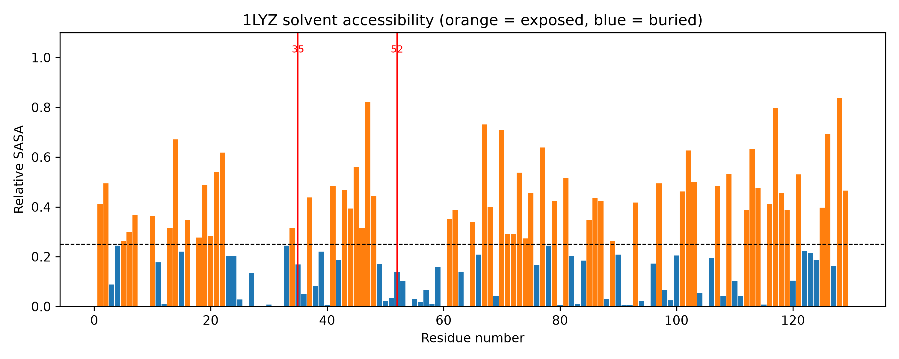
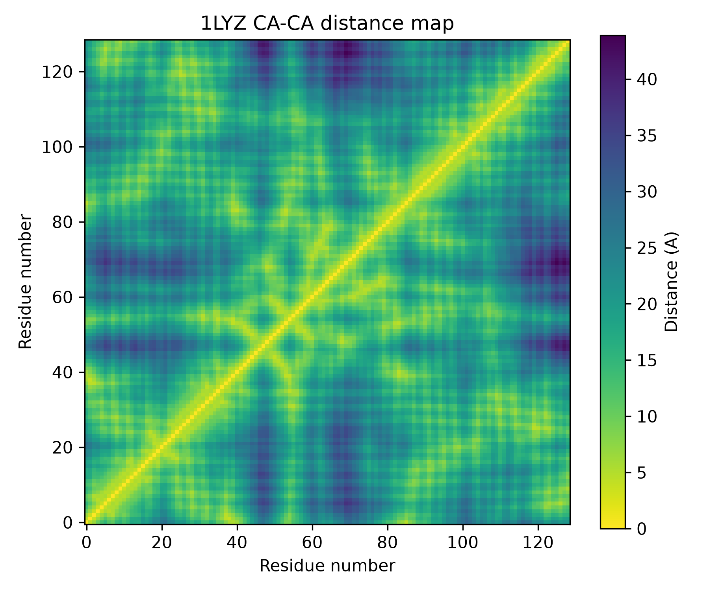
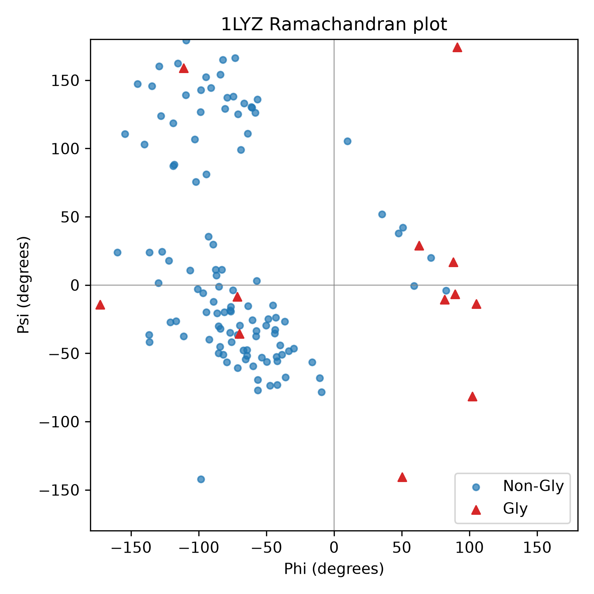
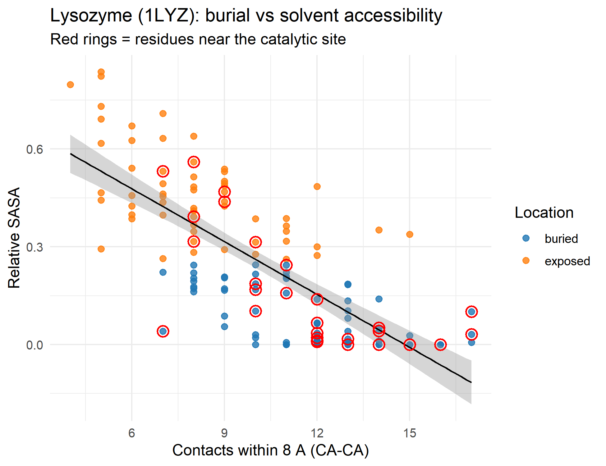

# Structural Analysis of Hen Egg-White Lysozyme (PDB: 1LYZ)

A beginner-level structural bioinformatics project in Python (Biopython) and R. It analyses the 3D structure of hen egg-white lysozyme to describe how exposed or buried each residue is, how residues pack together, whether the backbone geometry is reasonable, and how the catalytic site is organised.

**Key results**

- 129 residues analysed: 60 exposed (46.5%) and 69 buried (53.5%)
- Relative solvent accessibility and residue contacts are strongly negatively correlated (r = -0.73)
- All 4 known disulfide bonds were recovered (Cys6-Cys127, Cys30-Cys115, Cys64-Cys80, Cys76-Cys94)
- The catalytic residues Glu35 and Asp52 are both classed as buried (relative SASA 0.17 and 0.14)

---

## 1. Aim

To characterise the 3D structure of lysozyme (PDB: 1LYZ) by:

1. calculating the solvent accessibility of every residue,
2. mapping residue-residue contacts,
3. checking backbone geometry with a Ramachandran plot,
4. identifying the residues around the catalytic site (Glu35 and Asp52),
5. detecting disulfide bonds.

## 2. Background

Lysozyme is an enzyme that breaks down bacterial cell walls. Hen egg-white lysozyme is a small, single-chain protein of 129 residues and a classic model in structural biology. Its catalytic residues are Glu35 and Asp52, and its structure is stabilised by four disulfide bonds. Because these features are well documented, they provide a useful check on the results of the analysis.

## 3. Tools and methods

| Step | Method | Tool |
|------|--------|------|
| Structure download | RCSB PDB entry 1LYZ | `urllib` |
| Parsing | Water and ligands removed, protein chain kept | Biopython `Bio.PDB` |
| Solvent accessibility | Shrake-Rupley algorithm; relative SASA = SASA / maximum SASA of that residue type (Tien et al., 2013); residues with relative SASA >= 0.25 called "exposed" | `Bio.PDB.SASA` |
| Contacts | Number of other residues with CA-CA distance below 8 Å | NumPy |
| Backbone angles | Phi/psi angles | `PPBuilder` |
| Catalytic site | All residues with any atom within 5 Å of Glu35 or Asp52 | `NeighborSearch` |
| Disulfide bonds | Cys SG-SG distance below 2.5 Å | Biopython |
| Plots | Python figures and one R figure | matplotlib, ggplot2 |

## 4. Repository contents

```
lysozyme-structure-analysis/
├── lysozyme_analysis.py        # main analysis script
├── plot_r.R                    # R plot (run after the Python script)
├── requirements.txt            # Python packages
├── README.md
└── results/
    ├── residue_table.csv
    ├── catalytic_site_residues.csv
    ├── disulfide_bonds.csv
    ├── contact_map.png
    ├── ramachandran.png
    ├── rsasa_profile.png
    └── rsasa_vs_contacts_R.png
```

## 5. How to run

```bash
# 1. Clone the repository
git clone https://github.com/[YOUR-USERNAME]/lysozyme-structure-analysis.git
cd lysozyme-structure-analysis

# 2. Install Python packages
python -m pip install -r requirements.txt

# 3. Run the analysis (downloads 1LYZ automatically)
python lysozyme_analysis.py
```

Then, in R or RStudio, set the working directory to the project folder and run:

```r
install.packages("ggplot2")   # only once
source("plot_r.R")
```

## 6. Results

### 6.1 Summary

| Measurement | Value |
|-------------|-------|
| Residues analysed | 129 |
| Exposed residues (relative SASA >= 0.25) | 60 |
| Buried residues | 69 |
| Fully buried residues (SASA = 0) | 13 |
| Mean relative SASA | 0.26 |
| Contacts per residue (8 Å, CA-CA) | 4 to 17 (mean 9.95) |
| Correlation: relative SASA vs contacts | -0.73 |
| Disulfide bonds found | 4 |
| Residues within 5 Å of Glu35/Asp52 | 28 (21 buried, 7 exposed) |

### 6.2 Solvent accessibility along the sequence



*Relative solvent accessibility of each residue. Orange bars are exposed, blue bars are buried, the dashed line is the 0.25 cutoff, and red lines mark Glu35 and Asp52.*

**Observation:** The structure is split almost evenly between exposed (60) and buried (69) residues. Thirteen residues have no accessible surface at all (residues 8, 9, 17, 26, 28, 29, 31, 32, 54, 60, 64, 95 and 105), which appear as missing bars in the plot. The most exposed residues are Arg128 (0.84), Thr47 (0.82) and Gly117 (0.80). Polar and charged residues (D, E, K, R, N, Q, H, S, T, Y) have a mean relative SASA of 0.34, compared with 0.13 for hydrophobic residues (A, V, I, L, M, F, W, C), as expected for a folded globular protein. Both catalytic residues, Glu35 (0.17) and Asp52 (0.14), fall below the 0.25 cutoff.

### 6.3 Contact map



*CA-CA distance map of lysozyme. Yellow means residues are close together in 3D space and dark purple means they are far apart. The axes show the residue index starting from 0.*

**Observation:** The bright diagonal shows residues that are neighbours in the sequence. Short streaks running perpendicular to the diagonal around residues 40-60 are a pattern typical of strands pairing up in a small β-sheet. Dark bands near residues 47 and 70 mean that these residues are far from most of the rest of the chain, which matches the solvent accessibility result, where Thr47 and Pro70 are among the most exposed residues.

### 6.4 Ramachandran plot



*Phi/psi angles for every residue with both angles defined. Glycine is shown as red triangles because it is less restricted than other residues.*

**Observation:** Most non-glycine residues fall in two main regions: the β-strand region (upper left) and the right-handed α-helix region (lower left). A few non-glycine residues have positive phi values, and glycine residues appear in the positive-phi area that other residues rarely occupy. One non-glycine residue near (-98, -142) lies in a normally disfavoured region and would be worth checking in a more detailed validation.

### 6.5 Burial vs solvent accessibility (R)



*Relative SASA against the number of contacts within 8 Å. The black line is a linear fit with its confidence band, and red rings mark residues near the catalytic site.*

**Observation:** Residues with more neighbours are less exposed (r = -0.73), so the contact count works as a simple measure of burial. Most residues around the catalytic site sit on the right (many contacts, low SASA), with a few exposed ones on the left.

### 6.6 Catalytic site

The 28 residues within 5 Å of Glu35 or Asp52 form four stretches of the sequence: 30-37, 42-46, 50-60 and 108-111. The full list is in `results/catalytic_site_residues.csv`. Selected residues:

| Residue | Relative SASA | Location | Contacts |
|---------|---------------|----------|----------|
| Glu35 | 0.169 | buried | 10 |
| Asp52 | 0.139 | buried | 12 |
| Asn37 | 0.438 | exposed | 9 |
| Arg45 | 0.560 | exposed | 8 |
| Tyr53 | 0.101 | buried | 17 |
| Trp108 | 0.041 | buried | 7 |
| Val109 | 0.532 | exposed | 7 |
| Trp111 | 0.042 | buried | 14 |

**Observation:** Of the 28 site residues, 21 are buried and 7 are exposed. The mix of buried and partly exposed residues is consistent with a catalytic site located in a cleft: the catalytic residues sit below the surface but are surrounded by residues that face the solvent. Trp108 is among the residues reported in the literature to line the substrate-binding cleft.

### 6.7 Disulfide bonds

| Cys 1 | Cys 2 | SG-SG distance (Å) |
|-------|-------|--------------------|
| 6 | 127 | 2.06 |
| 30 | 115 | 2.42 |
| 64 | 80 | 2.34 |
| 76 | 94 | 2.22 |

**Observation:** All four disulfide bonds expected for hen lysozyme were detected. The distances range from 2.06 to 2.42 Å. A typical disulfide S-S distance is about 2.05 Å, so some of these are a little long, which may reflect the age and resolution of the 1LYZ model.

## 7. Conclusions

- Lysozyme is roughly half buried and half exposed, with polar residues mainly on the surface and hydrophobic residues in the core.
- Glu35 and Asp52 are buried but surrounded by exposed residues, consistent with a catalytic site in a cleft.
- All four disulfide bonds were recovered, and the backbone angles fall mainly in the expected helix and strand regions, with one unusual residue worth further checking.

## 8. Limitations

- Only a single static crystal structure was analysed, so protein dynamics are not captured.
- The contact definition uses CA atoms only, which is a simple approximation.
- Relative SASA depends on the chosen maximum-ASA reference values and the 0.25 exposure cutoff.
- The Ramachandran plot was inspected by eye and no formal validation (for example MolProbity) was run.

## 9. Possible extensions

- Compare with another lysozyme structure (for example, human lysozyme).
- Add secondary-structure assignment with DSSP.
- Visualise exposed residues and the catalytic site in PyMOL or ChimeraX.

## 10. References

- Cock PJA et al. (2009). Biopython: freely available Python tools for computational molecular biology and bioinformatics. *Bioinformatics* 25(11):1422-1423.
- Shrake A, Rupley JA (1973). Environment and exposure to solvent of protein atoms. Lysozyme and insulin. *J Mol Biol* 79:351-371.
- Tien MZ et al. (2013). Maximum allowed solvent accessibilities of residues in proteins. *PLoS ONE* 8(11):e80635.
- RCSB Protein Data Bank, entry 1LYZ: https://www.rcsb.org/structure/1LYZ

## 11. Author

[Your name], BSc Biotechnology, [your university].
